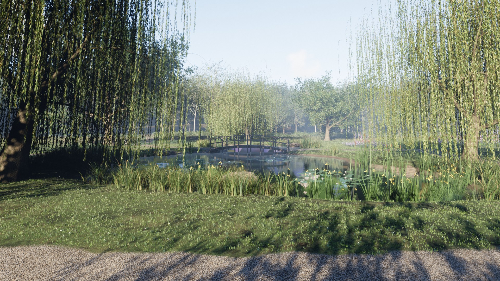
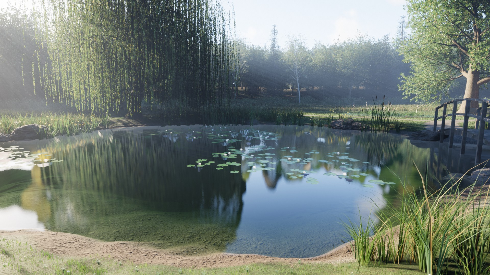
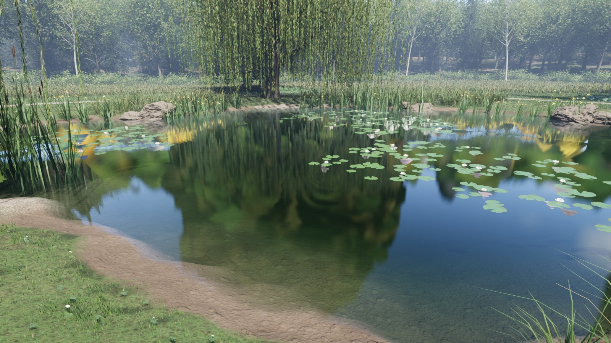

# Solstice Garden

[](https://github.com/SamG-Coder/solstice-garden/actions/workflows/ci.yml)
[](https://github.com/SamG-Coder/solstice-garden/actions/workflows/pages.yml)
[](LICENSE)

A quiet garden to walk in, in the browser: a still pond that mirrors the sky, weeping willows
leaning over the water, old oaks, lawns, a flowering meadow and deep borders, with a timber
footbridge across the pond's waist and a seat under an oak.

**[Walk in the garden](https://samg-coder.github.io/solstice-garden/)** in a WebGPU browser such
as Chrome or Edge, on a computer with a discrete GPU. The scene is 270 MB and streams as you
look around.



| The footbridge | Water lilies |
|---|---|
|  |  |

It is built with [Solstice](https://github.com/SamG-Coder/solstice), a real-time renderer in Rust
and WebGPU with virtualized geometry and dynamic global illumination, which this repository
carries and extends. Everything in the garden is grown or built by code when the scene is baked:
no models, photographs or textures are loaded from anywhere. Every leaf, blade and petal is
geometry, 1.1 billion triangles of it as the garden stands.

## What is in it

- **The pond**: two lobes joined at a narrow waist, with a shallow shelf, mirror reflections,
  ripples that follow the wind, white and pink water lilies, flag iris and reedmace in the
  margins, and boulders along the banks.
- **Trees**: three weeping willows, five old oaks, a stand of birches, and a wood of about 1,800
  trees closing the garden in.
- **Grass**: mown lawn with daisies and clover, a meadow with buttercups, oxeye daisies and red
  clover, and rough grass on the banks.
- **Borders**: lavender, catmint, salvia, delphiniums, foxgloves, daisies, poppies and alliums in
  the sun; ferns, hostas and white foxgloves in the shade of the oaks.
- **Woodwork**: an arched oak footbridge and a slatted seat, with gravel paths between them.
- **The day**: the hour stands still at a low evening sun until you move it, from dawn through
  sunset to night. Clouds drift, motes hang in the light, and at night there are stars and
  fireflies. Breeze, water, birdsong and crickets are made in the page, with no recordings.

## Walking

The page opens on a slow guided stroll around the pond. Click the garden, or press a movement
key, to walk yourself.

| | |
|---|---|
| **Click** | look around (Esc lets go) |
| **W A S D** or arrows | walk |
| **Shift** | walk faster |
| **Stroll** | go back to the guided stroll |
| **Hour** | the time of day |
| **Calm** | the weather: click for the next sky |
| **Sound**, **Full screen** | as they say |

You walk on the ground and over the bridge; the water and the garden's own trees stop you.

Add to the address: `?time=7:30` to start at an hour, `?day-length=7200` to let the day pass (a
whole one in that many seconds), `?weather=overcast` for a sky, `?quality=low` (or `medium`,
`high`) for slower or faster GPUs, `?quiet` for no sound, and `?stats` for the frame rate.

## Building it

It needs [Rust](https://rustup.rs) (the version in `rust-toolchain.toml` installs itself) and
Python 3 to serve the site.

Bake the garden, which takes a few minutes and writes `assets/garden.solstice`:

```bash
cargo run --release -p bake -- --garden --output assets/garden.solstice
```

Build the site into `dist/`:

```bash
bash scripts/build-web.sh
```

Serve it, then open <http://localhost:8765> in Chrome or Edge:

```bash
python scripts/serve.py
```

The native viewer opens the same scene in a window, and can save stills:

```bash
cargo run --release -p viewer -- assets/garden.solstice --time 17:30 --weather calm
```

## Where things are

| | |
|---|---|
| `apps/bake/src/garden/` | The garden: its site plan (`site.rs`), the land, trees, grass, plants, rocks and woodwork |
| `apps/viewer/web/garden.html` | The page: the stroll, walking, the day and the sound |
| `crates/solstice-procgen/species/` | The trees, as text: `willow.species`, `old_oak.species` and the rest |
| `crates/solstice-render/shaders/ocean/pond.wgsl` | The pond's water |
| `scene.txt` | Which release holds the scene the site serves |
| [ENGINE.md](ENGINE.md) | The engine's own documentation |

## How the site is published

The scene is too big for a repository's history and too slow to bake in CI, so it is baked on a
PC and kept in a [release](https://github.com/SamG-Coder/solstice-garden/releases). `scene.txt`
names that release and the scene's checksum. On every push to `main`, the
[Pages workflow](.github/workflows/pages.yml) builds the viewer, copies the scene out of the
release into the site, checks it against the checksum, and deploys to GitHub Pages. The site
serves its own copy because a browser cannot stream a file from a release.

After changing the garden, bake and publish it. The script uploads a new release only if the
scene changed, then pushes `main`, which deploys:

```bash
python scripts/publish-garden.py --bake
```

## Licence

MIT, as Solstice is: see [LICENSE](LICENSE).
